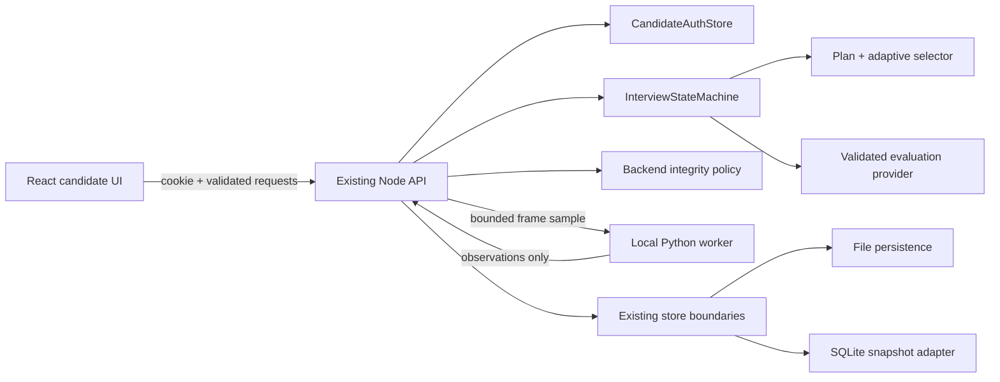

# Phase 9 — Architecture, service configuration and reliability

## Responsibilities and verified behavior

| Boundary | Existing implementation and authority |
| --- | --- |
| React/TypeScript | Candidate UI, permission prompts, camera preview, optional browser speech recognition and synthesis, editable transcripts. No secrets or session termination authority. |
| Node backend | Authentication, owned resumes/profiles, interview orchestration and round constraints, current question, answer validation, rolling state, warning policy, completed reports and progress. |
| Python | A local JSON-lines subprocess (`ProctoringWorker` / `proctoring/worker.py`). Returns schema-validated observations only. No HTTP termination route, account database connection or warning authority. Backend validates authenticated ownership, interview token and state before frame analysis. |
| AI provider adapters | Structured narrative evaluation behind the existing schema gateway; application code calculates final scores. Deterministic mode is heuristic practice. External credentials remain server-side. |
| Resume, questions, reports | Current resume understanding and career detection are local structured analysis; question selection is application-owned adaptive logic constrained by the plan; detailed reports/roadmaps use application code and evaluated answer evidence. These are not advertised as verified live LLM generation. |
| Speech | Browser speech APIs, subject to browser/device support and permission. No server-side Whisper/TTS service has been configured or tested by this milestone. Browser recognition can use the browser vendor's service. |
| Persistence | Existing file mode remains the compatible default. Optional SQLite stores the existing account, interview and report snapshots in namespaced database rows, including assessments inside interview snapshots. No competing role/session model or ORM. |



## Reliability changes

- Central Zod-validated service settings; unknown modes and malformed ports/origins/timeouts fail at startup. Load `.env` before provider selection. Explicit `live` mode requires credentials; default `deterministic` never activates an external provider because a key happens to exist. `auto` retains optional credential discovery for callers who choose it.
- SQLite uses prepared statements, JSON-valid rows, WAL, full synchronous commits, transaction rollback, schema-version guard and one active writer per data directory. A stale process lock is reclaimed only when its PID no longer exists. An active/unknown/invalid lock fails closed. The application supports a single Node API process; it is not a distributed persistence/locking design. File mode also requires a single writer.
- Existing file-session saves and retention rewrites use temporary files and atomic rename. Candidate account and report file writes already used that pattern.
- Stored account records are schema-validated. Corrupted account data is not silently replaced with an empty store.
- Exact-origin allowlist and same-origin checks replace wildcard CORS. Credentials are allowed only for accepted origins. Cross-site requests without an origin are rejected. Body formats, byte limits and malformed JSON produce 415, 413 and 400 responses. Validated schema errors remain 400; unauthorized and foreign-session access remain 401/404.
- Bounded per-IP login/registration attempts return 429 with Retry-After. Counters are process-local and not a substitute for shared edge rate limiting in a multi-server deployment.
- Private API responses disable caching and MIME sniffing. Unexpected failures return a generic message rather than raw provider responses, credentials or filesystem details. Logs record method/path and error class only.
- External provider HTTP calls have bounded timeouts. Missing/invalid structured narrative evaluations now return retryable 503 errors instead of inventing a zero score. The current question and skill evidence remain unchanged and the same answer can be retried after recovery. Core state returns to IN_PROGRESS when evaluation throws.
- Python timeouts are configurable, subprocess input errors are handled and process shutdown closes the worker/database.
- `GET /health` reports configured modes and limitations without secrets. It does **not** prove external provider credentials, physical camera/microphone availability or model readiness.

## Configuration

See `.env.example`. Variables are server-side unless explicitly stated:

| Variable | Default / purpose |
| --- | --- |
| `INTERVIEW_PROVIDER` | `deterministic`; choose `auto` or explicit `live` deliberately |
| `INTERVIEW_STORAGE` | `file`; `sqlite` enables database adapter |
| `INTERVIEW_DATA_DIR` | `.data`, resolved from project working directory |
| `API_HOST`, `PORT` | `127.0.0.1`, `3000` |
| `INTERVIEW_ALLOWED_ORIGINS` | Exact comma-separated HTTP(S) origins, localhost/127.0.0.1:5173 by default; no wildcard/trailing slash |
| `TRUST_PROXY` | `false`; only enable behind your trusted reverse proxy to honor forwarded HTTPS for secure cookies |
| `AUTH_ATTEMPTS_PER_WINDOW`, `AUTH_WINDOW_MS` | 30 attempts / 900000 ms per socket IP, login and registration combined |
| `AI_HTTP_TIMEOUT_MS` | 30000, range 1000–120000 |
| `PROCTORING_TIMEOUT_MS` | 20000, range 1000–120000 |
| `PROCTORING_PYTHON` | Optional local Python executable; existing project virtual environment is preferred |
| `OPENAI_API_KEY`, `OPENROUTER_API_KEY`, `ANTHROPIC_API_KEY` | Existing provider credentials, server-side only; never use `VITE_` prefixes |
| `API_PROXY_TARGET` | Optional Vite development proxy target; defaults to http://127.0.0.1:3000 |

Use the same-origin frontend proxy in development and a trusted HTTPS reverse proxy in deployment. The development proxy preserves the request Host; explicit configured origins also support proxies that rewrite it. Frontend API calls include credentials. No browser-side shared secret or Python-controlled termination endpoint is added.

## Safe SQLite migration (Windows PowerShell)

SQLite mode uses Node's built-in SQLite module and needs Node >=22.13; tested here on Node 24.15.0. This API is experimental in Node 24; see the [Node 24 SQLite documentation](https://nodejs.org/docs/latest-v24.x/api/sqlite.html). File mode remains available without that module. No dependency installation is required.

1. Stop the API with Ctrl+C. Do not run migration while the file-mode API is active.
2. Back up the entire data directory to a separate, private location. Do not overwrite an earlier backup.
3. From the project directory, run the explicit migration:

```powershell
Set-Location 'D:\AI Mock Interview Platform'
# Set this only if you use a different data directory:
# $env:INTERVIEW_DATA_DIR = '.data'
npm run migrate:sqlite
$env:INTERVIEW_STORAGE = 'sqlite'
$env:INTERVIEW_PROVIDER = 'deterministic'
npm run start:api
```

In another terminal at the same project directory:

```powershell
npm run dev:frontend
```

The migration validates account records, loads interview snapshots through the state machine, validates report schemas and matching IDs, copies source files into a timestamped `file-backup-*` directory, and commits the import and migration marker in one transaction. Original files remain untouched. Repeated migration does not overwrite imported data. A populated database without a migration marker is rejected, not merged. Startup refuses to silently ignore existing `candidates.json` when selecting SQLite without migration.

**Rollback:** stop the API. Keep a complete copy of `platform.sqlite` and its WAL/SHM files if present. File snapshots are a pre-migration snapshot; switching directly back to file mode will not include later database changes. To restore the pre-migration state, restore the complete pre-migration file backup together and explicitly set `INTERVIEW_STORAGE=file`. Later SQLite interviews are not exported automatically. Do not delete or merge account/report files independently. Back up SQLite only while the API is stopped, or use an SQLite-aware backup tool. No production candidate data was migrated during verification.

## Verification commands

```powershell
npm test
npm run build
npm run build:frontend
npm run demo
# Existing real browser journey using isolated SQLite verification accounts:
$env:INTERVIEW_STORAGE = 'sqlite'
$env:VERIFICATION_DATA_DIR = '.browser-verification/sqlite-ui-data'
npx tsx scripts/verify-product-ui.ts
```

New reliability integration tests cover origin rejection, malformed/wrong-format/oversized bodies, mode validation, authentication throttling, provider outage/retry without false scores, real file-to-SQLite migration, restart persistence, account isolation, cross-account warning requests, duplicate-writer refusal and transaction rollback. Existing Python integration tests still exercise real JPEG analysis; the browser verifier uses deterministic answer evaluation. No live external AI or physical speech hardware was tested.

## Files changed

- `src/api/ServiceConfig.ts`, `.env.example`: validated mode, service and security settings.
- `src/api/SQLiteDocuments.ts`, `DatabaseSessionStore.ts`, `migrateFileStorage.ts`, `scripts/migrate-storage.ts`: opt-in persistence adapter and explicit migration.
- `src/api/CandidateAuthStore.ts`, `InterviewReportStore.ts`, `server.ts`: database wiring, account validation, HTTP handling, health/status and service boundaries.
- `src/api/ProctoringWorker.ts`: configurable timeout and subprocess input-error cleanup.
- `src/core/session/InterviewSessionStore.ts`: atomic file writes; `InterviewStateMachine.ts`: restore state on evaluation failure.
- `src/core/assessment/evaluators/NarrativeEvaluator.ts`: reject unavailable evaluations rather than fabricating zero scores.
- `src/core/provider/providers/http.ts`: external HTTP timeout.
- `src/api/schemas.ts`, `frontend/src/types.ts`, `frontend/src/api.ts`: SQLite storage contract and credentialed requests.
- `frontend/vite.config.ts`, existing `scripts/verify-*.ts`: same-origin proxy preservation; product UI verifier accepts a separate verification data directory.
- `src/api/reliability.integration.test.ts`, `package.json`: focused integration checks and migration command.

## Results of this milestone
191 tests across 30 test files passed. Backend build, frontend build and deterministic demo passed. The actual candidate browser journey passed against a separate SQLite database, including two completed interviews, saved-profile reuse, skill/overall chart controls, mobile layout and reopening saved reports after API restart. Existing file-mode integration tests passed. The frontend retains its existing ~506 KB pre-gzip bundle warning.

Follow-up: the frontend bundle warning mentioned in this milestone was subsequently resolved by screen-level code splitting. Current production browser acceptance, device checks and remaining live speech/hardware limits are documented in `ACCEPTANCE.md`.
